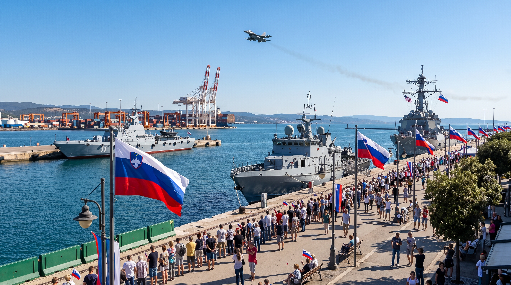

# Kaj je Soban v Kopru videl in česa ni

> *Odziv na kolumno Branka Sobana: [preberi izvirni tekst (PDF)](Branko_Soban.pdf)*

---

Branko Soban v svoji kolumni prihod italijanske patruljne ladje *Comandante Borsini* predstavi kot simbolno provokacijo in dokaz, da slovenska desnica še vedno ni opravila obračuna z lastno zgodovino. Toda pri tem spregleda pomembno razliko med **zgodovinskim dejstvom** in **politično interpretacijo**.

## Fašist ali vojaški častnik?

Costantino Borsini je bil nedvomno častnik italijanske kraljeve mornarice in je služil v času Mussolinijevega režima. Vendar za trditev, da je bil osebno fašist oziroma član fašistične stranke, ni znanih neposrednih dokazov. Bil je vojaški častnik države, ki jo je vodil fašistični režim. Toda to ni isto kot dokazano ideološko pripadništvo fašizmu. Podobno kot v nekdanji Jugoslaviji tudi v Italiji vojaška kariera brez lojalnosti vladajočemu sistemu praktično ni bila mogoča. V Jugoslaviji si težko postal visoki častnik JLA, ne da bi bil član Zveze komunistov. Pa vendar danes ne trdimo avtomatično, da je bil vsak jugoslovanski oficir fanatični komunistični ideolog.

## Dva totalitarizma

Soban govori o antifašizmu, vendar pri tem zamolči drugo plat evropske zgodovine. Fašizem in komunizem sta bila sicer različni ideologiji, vendar sta si bila v marsičem podobna:

- oba sta ustvarila **enostrankarski sistem**,
- oba sta **omejevala politične svoboščine**,
- oba sta **podrejala sodstvo in medije** oblasti,
- oba sta **preganjala politične nasprotnike**,
- oba sta posameznika **postavljala pod interese države** oziroma partije.

Prav zato je sodobna demokratična Evropa zgrajena na **zavračanju obeh totalitarizmov** in ne le enega od njiju.

## Bistvo praznika

Največji paradoks članka pa je, da skoraj povsem spregleda bistvo praznika, o katerem piše. **Dan suverenosti** ni spomin na italijanski fašizem niti na ideološke spore današnje slovenske politike. To je dan, ko je leta 1991 Slovenijo zapustil zadnji vojak Jugoslovanske ljudske armade. Zadnji vojak vojske, ki je nosila rdečo zvezdo in ki je nekaj mesecev prej poskušala z orožjem preprečiti demokratično odločitev slovenskih državljanov. Za številne Slovence rdeča zvezda zato ni zgolj simbol partizanskega boja, temveč tudi simbol vojske, ki je napadla nastajajočo slovensko državo.

## Koprska proslava

Zato je pomen koprske proslave precej preprostejši, kot ga želi prikazati Soban. Šlo je za praznovanje trenutka, ko so Slovenci prvič v zgodovini v celoti prevzeli odgovornost za svojo državo in svojo prihodnost. Prisotnost italijanske in ameriške vojaške ladje ter prelet lovcev Eurofighter ni pomenila nostalgije po vojnah ali glorifikacije vojske. Bila je predvsem simbolna potrditev zavezništva med državami, ki danes pripadajo istemu demokratičnemu prostoru. Slovenija, Italija in Združene države niso povezane zaradi skupne ideologije, temveč zaradi skupnih demokratičnih institucij, svobodnih volitev, vladavine prava in pripravljenosti, da te vrednote tudi branijo.

## Sklep

Soban zato napiše zanimivo kolumno o antifašizmu, vendar zgreši temo dogodka, ki ga kritizira. Namesto da bi pisal o slovenski suverenosti, odhodu zadnjega tujega vojaka in pomenu demokratične samoodločbe, napiše predvsem še eno razpravo o drugi svetovni vojni. Tako bralec na koncu izve veliko o preteklosti, precej manj pa o tem, kaj je bilo v Kopru sploh praznovano.
